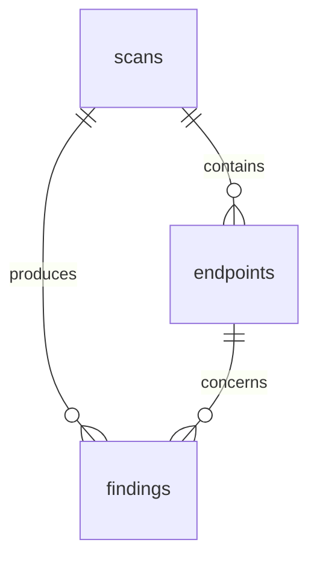

# Step 2 — Data model

## Goal

Store scans, discovered endpoints, and findings, distinguishing a clue from a confirmed result.

## Schema

`scans` stores the target, discovery mode, specification, profiles, configuration, and status (`pending`, `running`, `completed`, `failed`).

`endpoints` is the normalized list: method, path, parameters, body, tags, whether the specification declares authentication, and the security schemes (`security` JSON: `requirements` and `schemes`).

`findings` points at the scan and, when present, at the endpoint. The fields that matter when reading are:

- `category`: `bola`, `auth_jwt`, `data_exposure`, `resource_limits`, `bfla`, `business_flow`, `ssrf`, `injection`, `misconfig`, `inventory`, `unsafe_consumption`, `mass_assignment`
- `severity`: `critical`, `high`, `medium`, `low`
- `status`: `confirmed` or `potential`
- `evidence`: response excerpts, notes, affected endpoints
- `remediation`: what to change in the API, not how to exploit the flaw

Relationships and the migrations are in `backend/app/models/entities.py`, `backend/alembic/versions/001_initial.py`, and `002_endpoint_security.py`.

Startup calls `ensure_schema`. That creates missing tables and, on a database created before schemes were stored, adds the `security` column. `alembic upgrade head` on an empty database applies both revisions. Do not mix the two on a database that already has the tables and an empty Alembic version table.



## How to verify it

On startup, `ensure_schema` creates the tables and adds `endpoints.security` when that column is missing. The tests in `backend/tests/test_lab_scan.py` use in-memory SQLite and read the findings after the scan. `test_existing_database_gains_security_column` checks the column upgrade.

On an empty database you can also apply the migration, from the `backend` directory:

```bash
alembic upgrade head
```

Do not run it on a database that already has the tables created at startup, or Alembic will try to create them again.

## Concepts

Separating `confirmed` and `potential` is the choice that reduces false positives: the first status requires a counter-check, the second records only a signal.
