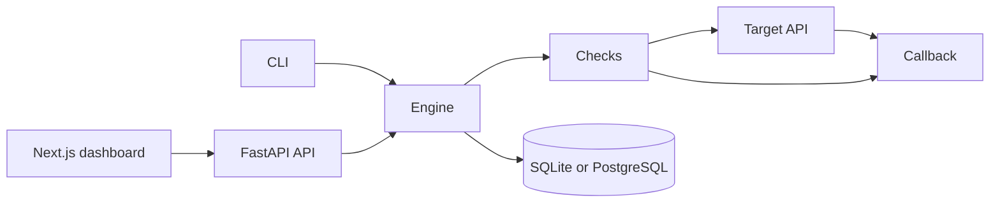

# 02 — Architecture

The dashboard does not talk to the target. It talks to the Argus API. The engine, in the same process as the API, talks to the target. The target, if it is vulnerable to SSRF, talks to the callback. Argus then reads the callback to confirm.

## Boundaries

- `frontend/` contains no security logic. It filters and displays.
- `backend/app/api` and `backend/app/cli.py` are two entrances to the same `create_scan` and `execute_scan`.
- `backend/app/engine/checks` does not write to the database. It returns drafts. The runner saves them.
- `targets/` is not a dependency of the engine. Tests start it as a real HTTP process, on `127.0.0.1` and a free port.

## Data

A scan starts as `pending`, moves to `running`, and ends as `completed` or `failed`. Discovered endpoints and findings stay tied to its id. The report is rebuilt from those rows: there is no second archive.

## Why the callback is a service

If the marker came back only because the lab wrote it itself, without an HTTP request, the test would not demonstrate an SSRF. The collaborator is a second server. The lab must reach it over the network. In Docker the two containers see each other by name. Locally they see each other on `127.0.0.1`.
